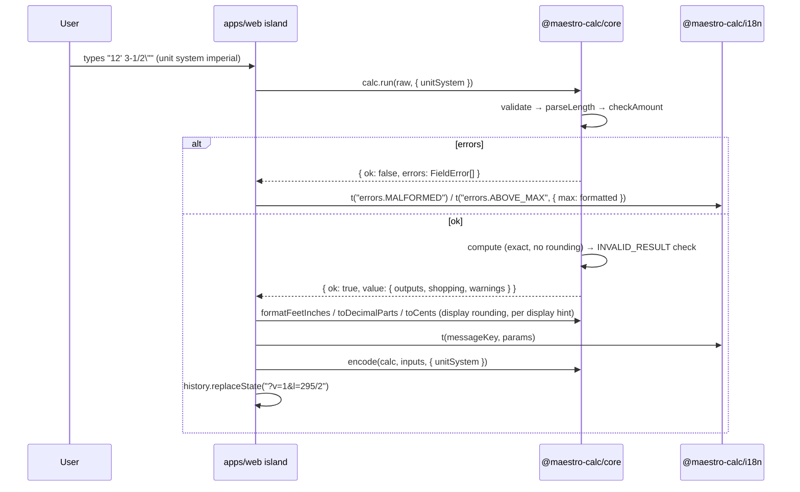

# Design: Foundation — Monorepo and Exact Core Engine

Implements PLAN.md §6.1–6.3 (quality gates only) and §12 phase B (first item). Inputs: `proposal.md` (incl. resolved question round), `explore.md` (orchestrator decisions 1–5 binding), and the delta specs under `specs/`. **The specs are the behavioral contract**: every name, code, signature, and text format below matches them. Revised 2026-10-22 after design review round 1 (see "Design review resolution" at the end).

## Technical Approach

Hexagonal split per PLAN §6.1: `packages/core` is the pure domain (exact numbers, units, money, formats, calculator contract, URL state codec, calculators); `packages/i18n` and `packages/data` are leaf content packages; `apps/web` is the only composition root and the only place that knows about DOM, Astro, locale, and materials together. Internal packages ship TypeScript source through `package.json#exports` (no build step). Exactness is guaranteed by a zero-dependency `Rational` over `bigint`; rounding happens only at the display/purchase boundary. Every gate (lint, format, typecheck, coverage, mutation) is blocking from the PR that introduces it.

## Package Layout and Public API

```
maestro-calc/
├── package.json            # private root: workspaces, scripts, ALL devDependencies
├── package-lock.json  .nvmrc (24)  tsconfig.base.json  tsconfig.json (tools)
├── eslint.config.js  prettier.config.js  .prettierignore  vitest.config.ts
├── .github/workflows/ci.yml  .github/dependabot.yml
├── packages/
│   ├── core/   package.json tsconfig.json tsconfig.src.json tsconfig.test.json vitest.config.ts stryker.config.mjs
│   │   └── src/
│   │       ├── index.ts                 # engine barrel (never re-exports calculators)
│   │       ├── result.ts                # Result<T,E>, ok, err
│   │       ├── errors.ts                # CoreError { code, reason? }
│   │       ├── error-codes.ts           # ALL_ERROR_CODES aggregate (runtime + type)
│   │       ├── rational/   rational.ts decimal.ts index.ts
│   │       ├── units/      dimension.ts unit.ts catalog.ts quantity.ts ops.ts index.ts
│   │       ├── money/      money.ts unit-price.ts parse.ts index.ts
│   │       ├── format/     rounding.ts decimal-parts.ts purchase.ts feet-inches.ts index.ts
│   │       │   └── length-parser/  scanner.ts parser.ts codes.ts index.ts
│   │       ├── calculator/ descriptors.ts define.ts validate.ts constraints.ts run.ts index.ts
│   │       ├── url/        url-values.ts codec.ts released.contract.test.ts index.ts
│   │       ├── calculators/rectangle-area/  rectangle-area.ts index.ts
│   │       └── __testing__/ arbitraries.ts fixture-box.ts property-runs.ts   # never exported
│   ├── data/   package.json tsconfig.json tsconfig.src.json tsconfig.test.json vitest.config.ts
│   │   └── src/ index.ts material.ts
│   └── i18n/   package.json tsconfig.json tsconfig.src.json tsconfig.test.json vitest.config.ts
│       └── src/ index.ts locales.ts translate.ts
│           └── catalogs/ en/{common,rectangle-area}.ts  es/{common,rectangle-area}.ts
└── apps/web/  package.json tsconfig.json tsconfig.app.json tsconfig.test.json astro.config.mjs vitest.config.ts public/
    └── src/ site.config.ts pages/index.astro lib/calculators.ts lib/*.test.ts lib/*.test-d.ts
```

Tests are colocated next to the unit under test (see Testing Architecture).

| Package (`private: true`, `type: module`, `sideEffects: false`) | `exports` | Public surface |
|---|---|---|
| `@maestro-calc/core` | `"."` → `src/index.ts`; `"./calculators/*"` → `src/calculators/*/index.ts` | `Rational`, `parseDecimal`, `Result`/`ok`/`err`, `CoreError`, `ALL_ERROR_CODES`; units: `DimensionName`, `Quantity`, `Unit`, unit constants, `quantity`, `valueIn`, `add`, `sub`, `negate`, `abs`, `compare`, `equals`, `isZero`, `sign`, `scale`, `divideScalar`, `ratio`, `multiply`, `divide`, `findUnit`; money: `Money`, `usd`, `addMoney`, `subMoney`, `compareMoney`, `equalsMoney`, `scaleMoney`, `multiplyCount`, `unitPrice`, `costOf`, `toCents`, `parseMoney`, `MONEY_PARSE_CODES`, and the types `UnitPrice`, `MoneyParseCode`, `MoneyParseError`; format: `roundToFraction`, `toDecimalParts`, `ceilToPurchaseUnits`, `formatFeetInches`, `parseLength`, `LENGTH_PARSE_CODES`, and the types `RoundingMode`, `DecimalParts`, `FeetInches`, `FeetInchesParts`, `FeetInchesOptions`, `LengthParseCode`, `LengthParseError`, `LengthParseOptions`; contract: `defineCalculator`, `DEFINITION_REASONS`, `FIELD_ERROR_CODES`, and the types `Calculator`, `CalculatorDefinition`, `ComputeResult`, `InputDescriptor` (with `LengthDescriptor`, `CountDescriptor`, `PercentDescriptor`, `SelectDescriptor`, `BooleanDescriptor`, `MoneyDescriptor`), `OutputDescriptor`, `DisplayHint`, `InputsOf`, `ValueOf`, `ShoppingLine`, `WarningEntry`, `UnitSystem`, `FieldError`, `FieldErrorCode`, `ValidateOptions`, `DefinitionReason`; codec: `encode`, `decode`, `RESERVED_URL_KEYS` |
| `@maestro-calc/data` | `"."` | `MaterialRecord`, `PurchaseUnit`, `MaterialSource`, `defineMaterial` |
| `@maestro-calc/i18n` | `"."`; `"./catalogs/*"` → `src/catalogs/*.ts` | `locales`, `defaultLocale`, `Locale`, `createTranslator`, `CatalogOf`, `ParamsOf` |
| `@maestro-calc/web` (`apps/web`) | none (app) | — |

Per-calculator subpaths (`@maestro-calc/core/calculators/rectangle-area`) and per-locale-per-calculator catalogs (`@maestro-calc/i18n/catalogs/es/rectangle-area`) keep each page's island bundle limited to what it renders, which is what lets 100+ calculators scale without a growing shared chunk. Unit, money, and format APIs are free functions for the same reason (unused operations tree-shake away).

### Dependency direction and enforcement

```
apps/web ──→ core, data, i18n          data ──→ core          i18n ──→ (nothing)          core ──→ (nothing)
```

| Layer | Mechanism |
|---|---|
| Resolution | Each `package.json` declares only allowed `@maestro-calc/*` deps (`"*"`); `exports` blocks deep imports (`@maestro-calc/core/src/...` fails to resolve under `moduleResolution: Bundler`). |
| Lint | `import-x/no-extraneous-dependencies` (per-package `packageDir`), `import-x/no-relative-packages`, `import-x/no-cycle`; `no-restricted-imports` patterns: core bans `@maestro-calc/*`, `astro*`, `node:*`; i18n bans `@maestro-calc/*`, `node:*`; data bans `@maestro-calc/i18n`, `@maestro-calc/web`, `node:*`; every package bans `@maestro-calc/*/src/*` (deep imports). |
| Purity (core) | `tsconfig.src.json` (`lib: ["ES2023"]`, `types: []`: no DOM, no Node globals, so `window`, `URLSearchParams`, `console`, `setTimeout` do not type-check; tests are excluded and compile in `tsconfig.test.json`). ESLint `@typescript-eslint/triple-slash-reference` (all `never`) blocks `/// <reference>` typing bypasses. ESLint `no-restricted-globals`: `window`, `document`, `location`, `history`, `navigator`, `localStorage`, `sessionStorage`, `fetch`, `process`, `globalThis`, `self`, `global`, `Date`, `performance`, `parseFloat` (purity rules do not apply to tests and `__testing__`); `no-restricted-properties`: `Math.random`, `Date.now`, `Number.parseFloat`; `no-restricted-syntax` for `.toFixed(` — float leakage is a lint error. Data and i18n use the same tsconfig purity. |
| Coverage honesty (core) | `no-warning-comments` with `terms: ['v8 ignore', 'c8 ignore', 'istanbul ignore']`, `location: 'anywhere'`, scoped to `packages/core/**`. |
| Style | `import-x/no-default-export` in packages; named exports only. |

## Architecture Decisions

| # | Decision | Alternatives rejected | Rationale |
|---|---|---|---|
| D1 | npm workspaces, root holds all devDependencies, no task runner | pnpm, Turborepo/Nx | Lockfile and CI already npm; 4 workspaces do not justify orchestration. Revisit at >6 packages or CI >5 min. |
| D2 | Internal packages export TS source; relative imports use `.ts` extensions with `allowImportingTsExtensions` + `rewriteRelativeImportExtensions` + `erasableSyntaxOnly` | Per-package build (tsc/tsdown), project references | Zero build latency for Vite/Astro/vitest. The three flags make a later `tsc` emit (or Node 24 native type stripping) work with no source changes. |
| D3 | `Rational` as a frozen class with public readonly `num`/`den` (`bigint`) | `#private` fields; functional module; fraction.js; number ticks | Canonical form makes deep structural equality equal value equality, so vitest `toEqual` works with no custom tester; `#private` fields would be invisible to `toEqual`. Methods give readable chaining; size < 5 KB. |
| D4 | Dimensions are exponent vectors over (length, mass) with named public aliases; quantities stored in canonical units (in, in², in³, lb, lb/in³) | Closed string union with a per-pair overload table; full type-level unit algebra | One generic `multiply`/`divide` derives every product; adding a dimension is one table row, not N new overloads. Named aliases keep the typed API readable. |
| D5 | Untrusted-input failures return `Result` (`{ ok: false, errors }`); programmer/invariant violations throw `CoreError` with `code` | Exceptions everywhere; Result everywhere | Bad input is expected and must be localized; dividing by zero after validation is a bug and must fail loudly. `compute` is total on validated inputs. |
| D6 | Hand-rolled field descriptors in core | zod 4, valibot | Rational/unit-aware, zero runtime deps, one descriptor drives defaults, validation, form metadata, URL codec, and i18n keys. zod stays build-time (MDX frontmatter) in web. |
| D7 | Calculators live in core under `calculators/<id>/`, each its own export subpath | Separate `packages/calculators` | PLAN §6.1 puts formulas in core. Material data arrives later through an injected port (see Extension Points), so core still depends on nothing. |
| D8 | URL values are canonical Rational text (lengths in inches, money in dollars), no unit suffix; the decoder uses strict per-kind URL parsers and never applies a default unit | Unit-suffixed user units (`3m`); decimals; reusing the form parsers | One canonical string per value makes decode∘encode idempotent and links stable even if a field's input unit changes. Reusing form parsers would make URL meaning depend on `defaultUnit` and the unit system. |
| D9 | Any comma in numeric input is rejected with the dedicated code `DECIMAL_COMMA` | Accept `,` as decimal; plain `MALFORMED` | `1,000 ft` silently parsed as 1 ft is a dangerous error; the dedicated code lets the UI say "use a period". Locale-aware input is a tracked follow-up. |
| D10 | Mutation job always runs, never path-filtered, and restores the Stryker incremental report on an exact cache key | Path-filtered workflow | A path-skipped required check stays pending forever. The cache is all-or-nothing per core change: the command runner cannot see which tests changed, so any change to a core input (sources, tests, config, lockfile, Node) yields a new key and a cold run (the measured cold time is recorded in `apply-progress.md`; the CI wall time grows with the mutant count and reaches the 20-minute trigger at PR 8, where the job is sharded by module, task 8.0 and the CI numbers under Performance levers). Sharding (PR 8, task 8.0): a `matrix` of runners (`rational` with `errors.ts` and `result.ts`, `units` with `money`, `format`, and from PR 9 `calculator` with `src/calculator/**` and, once it exists, `src/error-codes.ts`), one Stryker invocation per shard with `mutate` and the vitest command narrowed to the shard's modules plus `index.test.ts`; each shard has its own incremental report (`stryker-incremental-<hash>-<shard>.json`) and its own exact-key cache; the identity hash stays one superset for all shards, so any core input change colds every shard; only a PR that leaves every core input untouched gets the near-free warm run. A shard is split when its cold CI wall time exceeds 10 minutes (half the 20-minute trigger): `src/calculators/<id>` directories are grouped into shards whose `tests` list only their own directories plus `index.test.ts`. Required CI check: `mutation-gate` aggregates the `mutation (<shard>)` matrix jobs (`needs: mutation`, `if: always()`, fails unless the matrix succeeded), so branch protection keys on one stable name whatever the shard count. Cross-module kills dropped by sharding are intentional: a mutant that another module's tests used to kill gets that test path added to its shard, never a lower threshold. |
| D11 | `stryker.config.mjs` lives in `packages/core/` | Root config | Per-package configs scale when `data` formulas join mutation testing; the root script delegates. |
| D12 | i18n EN module per scope is the source of truth; ES module `as const satisfies CatalogOf<typeof en>`; no runtime locale fallback | Runtime EN fallback; JSON catalogs | Missing or extra ES keys are compile errors, so a fallback would only hide bugs; JSON loses the literal types needed for typed params. |
| D13 | Units, money, and format are free functions over immutable values | `Quantity` class with methods | Tree-shakeable per page; methods on a class are always bundled. `Rational` stays a class (D3) because every module needs all of it. |
| D14 | Canonical mass unit is the pound; mass units ship now | kg canonical; defer mass | US customary domain (like the inch for length): oz and short ton are unit fractions/integers of lb, and kg stays exact via 1 lb = 0.45359237 kg. Concrete/gravel calculators need mass and density next. |
| D15 | `Money` = exact Rational amount in USD; rounding to cents only at display | Integer minor units (cents) | Unit prices such as $0.37/ft² or $0.333/unit and their products must stay exact until the final display; cents would round intermediate results. |
| D16 | URL `/` emitted literally by a custom serializer; decoder accepts `/` and `%2F` | `URLSearchParams` (`%2F`) | RFC 3986 allows `/` in queries; links are shorter and readable when shared on WhatsApp. `URLSearchParams` is also not available in core's type environment. |
| D17 | Unit-system preference (`imperial`/`metric`) is a validate option and the reserved URL param `u` | Per-field unit selectors; metric-only pages | Bare numbers follow the user's system (PLAN §7.8 metric button) without changing URL value meaning. |

## Type-Level Design

### Result and error codes

```ts
type Result<T, E> =
  | { readonly ok: true; readonly value: T }
  | { readonly ok: false; readonly errors: readonly [E, ...E[]] };
```

Plain objects, no methods (tree-shakeable, structurally comparable). Single-value parsers return exactly one error. Codes are flat `UPPER_CASE` literals; each module exports `const X_CODES = [...] as const` and `type XCode = (typeof X_CODES)[number]`:

| Module | Returned codes (user-facing) | Thrown codes (`CoreError`) |
|---|---|---|
| rational | `parseDecimal`: `MALFORMED`, `DECIMAL_COMMA`; `fromString`: `MALFORMED`, `ZERO_DENOMINATOR` (a comma is `MALFORMED` there; `DECIMAL_COMMA` belongs to `parseDecimal` only). Arrays: `DECIMAL_PARSE_CODES`, `RATIONAL_PARSE_CODES` | `NOT_AN_INTEGER`, `ZERO_DENOMINATOR`, `DIVISION_BY_ZERO` |
| units / money | — / `EMPTY`, `MALFORMED`, `DECIMAL_COMMA`, `TOO_LARGE` | `DIMENSION_MISMATCH`, `DIVISION_BY_ZERO` |
| format | `EMPTY`, `MALFORMED`, `DECIMAL_COMMA`, `ZERO_DENOMINATOR`, `UNKNOWN_UNIT`, `TOO_LONG`, `TOO_LARGE` | `INVALID_DENOMINATOR`, `INVALID_PLACES`, `INVALID_MODE`, `NEGATIVE_QUANTITY` |
| calculator | adds `BELOW_MIN`, `ABOVE_MAX`, `UNKNOWN_OPTION` (`FieldErrorCode` = 10 codes) | `INVALID_DEFINITION` (+`reason`), `INVALID_RESULT` |
| url | `INVALID_VALUE`, `UNSUPPORTED_VERSION` (`UrlIssueCode`) | — |

`error-codes.ts` exports `ALL_ERROR_CODES = [...FIELD_ERROR_CODES, ...URL_ISSUE_CODES] as const` (12 user-facing codes, deduplicated union of the module literals) so web can prove every one has an `errors.<CODE>` message. Thrown codes are programming errors and have no message. Errors carry codes, optional `offset` (parsers), and canonical-string `params` — never prose.

### Rational

| Aspect | Rule |
|---|---|
| Invariants | `den > 0n`; `gcd(abs(num), den) = 1n`; zero is `0/1`. Equal values ⇒ identical fields, so `equals` is field comparison and `toEqual` works. |
| Construction | `private constructor`; `Rational.of(n, d = 1)` accepts `bigint` or safe-integer `number` (else throws `NOT_AN_INTEGER`); zero `d` throws `ZERO_DENOMINATOR`. `Rational.fromString(text)`: grammar `-?digits(/digits)?` → `Result` (`MALFORMED`, `ZERO_DENOMINATOR`). Free function `parseDecimal(text)`: grammar `sign? (digits ("." digits)? \| "." digits)` → `Result` (`DECIMAL_COMMA` if any comma, else `MALFORMED`). Neither goes through `number`, and neither has a length cap (caps live at the boundaries: `validate` 128, `parseLength` 128, URL values 256). Constants `ZERO`, `ONE`. |
| Ops | `add sub mul div neg abs inv compare equals sign isZero isInteger` return new frozen instances; `floor`/`ceil` return `bigint`. |
| Exits | `toString()` canonical `"n"`/`"n/d"`. `toNumber()` is the only lossy exit: if both magnitudes ≤ 2^53−1 it returns `Number(num) / Number(den)` (correctly rounded); otherwise it shifts by the bit-length difference so the bigint quotient keeps ≥ 64 significant bits, converts, and rescales by a power of two (within one ulp; `(10^400+1)/10^399` gives 10, never `NaN`). |
| Leak guards | `toJSON()` throws `TypeError`; `[Symbol.toPrimitive]` returns `toString()` for hint `string` and throws `TypeError` for `number`/`default` (blocks `r + 1`, `r > s`). |

### Units and quantities

```ts
interface Dimensions {                       // single source of truth (type + runtime table)
  length:  { length: 1;  mass: 0 };
  area:    { length: 2;  mass: 0 };
  volume:  { length: 3;  mass: 0 };
  mass:    { length: 0;  mass: 1 };
  density: { length: -3; mass: 1 };
}
type DimensionName = keyof Dimensions;
type Exponents = { readonly length: number; readonly mass: number };
interface Unit<D extends DimensionName> { readonly id: UnitIdOf<D>; readonly dimension: D; readonly factor: Rational }
declare const brand: unique symbol;
interface Quantity<D extends DimensionName> { readonly exponents: Exponents; readonly canonical: Rational; readonly [brand]: D }

// Derived at the type level: add/subtract exponent literals with a bounded helper over −6..6,
// then map the vector back to a name; no name ⇒ never.
type Product<A extends DimensionName, B extends DimensionName> = NameOf<AddVec<Dimensions[A], Dimensions[B]>>;
type Quotient<A extends DimensionName, B extends DimensionName> = NameOf<SubVec<Dimensions[A], Dimensions[B]>>;
declare function multiply<A extends DimensionName, B extends DimensionName>(
  a: Quantity<A>, b: Quantity<B> & Named<Product<A, B>>): Quantity<Product<A, B>>; // Named<never> = never ⇒ call rejected
declare function add<D extends DimensionName>(a: Quantity<D>, b: Quantity<NoInfer<D>>): Quantity<D>;
```

- The helper is generic in the exponents, so its size does not grow with the number of named dimensions (no quadratic overload table). `area × area` (length 4) and `mass × length` have no name and are compile errors; at runtime `multiply`/`divide` compute the vector and throw `DIMENSION_MISMATCH` when it has no name.
- Known limitation (PR 4 Judgment Day A-2): the compile-time same-dimension check needs a literal dimension. A value widened to the union `Quantity<DimensionName>` (for example from an array of mixed quantities) is accepted where one dimension is expected, so `add(widened, area)` type-checks; the runtime exponent guard still throws `DIMENSION_MISMATCH`. Callers keep dimensions literal (descriptors and `defineCalculator` do); the contract layer never widens.
- Every same-dimension op (`add`, `sub`, `compare`, `equals`, `ratio`) and `valueIn` compares exponent vectors at runtime and throws `DIMENSION_MISMATCH` for untyped callers.
- Unit table (28 units) exactly as in the units spec: length/area/volume factors are exact squares/cubes of length factors computed at module init; mass factors `lb 1`, `oz 1/16`, `ton 2000`, `kg 10^8/45359237`, `tonne 10^11/45359237`; density factors are mass/volume factors (`lb/in3`, `lb/ft3`, `lb/yd3`, `ton/yd3`, `kg/m3`). No float literal appears.
- API: `quantity(x, unit)`, `valueIn(q, unit)`, `add`, `sub`, `negate`, `abs`, `compare`, `equals`, `isZero`, `sign`, `scale(q, k)`, `divideScalar(q, k)`, `ratio(a, b): Rational`, `multiply`, `divide`, `findUnit(dimension, id): Unit | undefined`. The `unique symbol` brand forbids object-literal construction outside the module.
- Angle and dimensionless ratios are not dimensions in this change; the roof-pitch change may add a dimensionless kind (zero vector).

### Money

```ts
interface Money { readonly currency: 'USD'; readonly amount: Rational; readonly [brand]: true }  // exact dollars, may be negative; branded like Quantity, so a literal is a type error
interface UnitPrice<D extends DimensionName> { readonly currency: 'USD'; readonly perCanonical: Rational; readonly exponents: Exponents; readonly [brand]: D }
declare function unitPrice<D extends DimensionName>(m: Money, unit: Unit<D>): UnitPrice<D>;  // m / unit.factor
declare function costOf<D extends DimensionName>(p: UnitPrice<D>, q: Quantity<NoInfer<D>>): Money; // perCanonical × canonical
```

`usd`, `addMoney`, `subMoney`, `compareMoney`, `equalsMoney`, `scaleMoney(m, k)`, `multiplyCount(m, n: number | bigint)` (n non-negative safe integer or bigint, e.g. from `ceilToPurchaseUnits`), `toCents(m) = toDecimalParts(m.amount, 2, 'nearest')`, `parseMoney(text)` (grammar `"$"? udecimal`; precedence `EMPTY`, `DECIMAL_COMMA`, `TOO_LARGE` (>18-digit run), `MALFORMED`). Money and quantities are distinct types (`Money`, `Quantity` and `UnitPrice` are all branded, and the `*Money` suffix keeps money away from the quantity `add`/`sub`/`compare` of the same root barrel); untyped mixing throws `DIMENSION_MISMATCH`.

### Rounding and formatting

- `RoundingMode = 'nearest' | 'up' | 'down'`: nearest = ties away from zero; up = toward +∞; down = toward −∞. One module-internal kernel `roundScaled(r, scale, mode): bigint` (exported from `rounding.ts` for `decimal-parts.ts`, not from the barrel) serves both rounding functions. It looks the mode up with `Object.hasOwn`, so any other value, including inherited names such as `toString`, throws `INVALID_MODE` in all three public functions.
- `roundToFraction(value, denominator, mode = 'nearest'): bigint` — tick count `k` with result `k/denominator`; `denominator` integer 2..64 else throws `INVALID_DENOMINATOR`.
- `toDecimalParts(value, places, mode = 'nearest'): { negative, integer: bigint, fraction: string }` — `places` integer 0..12 else throws `INVALID_PLACES`; unknown `mode` throws `INVALID_MODE`; `fraction` has exactly `places` digits; no negative zero. Web localizes separators without passing through `number`.
- `ceilToPurchaseUnits(quantity: Rational): bigint` — smallest non-negative integer ≥ quantity; negative throws `NEGATIVE_QUANTITY`.
- `formatFeetInches(length, { denominator, mode = 'nearest' }): { parts, text }` rounds the **signed total inches first** via `roundToFraction`, then decomposes into `parts = { negative, feet, inches, fraction: { numerator, denominator } }` (`0 ≤ inches ≤ 11`, reduced fraction, zero fraction `0/1`, no negative zero). Carry is correct by construction. `text` is the canonical ASCII form `[-]<feet>' <inches>"`: `5' 3 1/2"`, `1' 0"`, `0' 11 15/16"`, `0' 3/4"`, `-0' 1/64"` (feet always present; fraction joined to whole inches by a space).

### Length parser

Hand-written scanner → tokens → single-pass recursive descent producing the value directly (the grammar is flat; an AST adds no value). The grammar is the EBNF in `specs/fraction-format/spec.md`, including its `ws*` slots and the `hyphen` leniency (U+2212 where a hyphen separator is allowed); the steps below summarize it:

1. Length > 128 chars → `TOO_LONG`; trim `ws` (U+0020, U+0009, U+00A0); empty → `EMPTY`; any comma → `DECIMAL_COMMA`; any other control/newline → `MALFORMED`.
2. Scanner maps smart marks (`′ ’` → feet, `″ ”` → inch, `−` → minus), emits `UINT` (a run > 18 digits → `TOO_LARGE`), `.`, `/`, `-`, `+`, `WS`, `FEETMARK`, `INCHMARK`, and unit tokens `[A-Za-z]+[0-9]*` (case-insensitive lookup). A unit token glued to a digit that is `e`/`x` + digit → `MALFORMED` (exponent/hex); any other unknown unit token after a number → `UNKNOWN_UNIT` (`ft2`, `m2`, `furlongs`, `sq`).
3. Parser: `input := sign? (compound | simple)`; `compound := uint FEETMARK sep number INCHMARK?` (feet integer only; word feet mark requires an inch mark, so `5 ft 2` → `MALFORMED`); `simple := number UNIT?`; `number := mixed | fraction | decimal`; denominator 0 → `ZERO_DENOMINATOR`. `UNIT := FEETMARK | INCHMARK | unit-word`.

`parseLength(text, { defaultUnit = in }) → Result<Quantity<'length'>, { code: LengthParseCode; offset?: number }>`; it never throws. Inches ≥ 12 after feet are accepted (`5' 15"` = 75 in). U+2212 is accepted wherever a hyphen separator is (`5'−3"`, `3−1/2`), a deliberate leniency for phone keyboards. `offset` counts UTF-16 code units; when the input ends too early it is the end of the last token. Code precedence: scanner codes in scan order, then `ZERO_DENOMINATOR`, then `MALFORMED`.

## Calculator Contract

```ts
type UnitSystem = 'imperial' | 'metric';
type Base<K extends string> = { readonly key: K; readonly urlKey: string };
type InputDescriptor =
  | Base<string> & { kind: 'length'; default: Quantity<'length'>; defaultUnit: 'in' | 'ft' | 'yd'; metricDefaultUnit: 'mm' | 'cm' | 'm'; min?: Quantity<'length'>; max?: Quantity<'length'> }
  | Base<string> & { kind: 'count'; default: number; min?: number; max?: number }          // defaults 0 .. MAX_SAFE_INTEGER
  | Base<string> & { kind: 'percent'; default: Rational; min?: Rational; max?: Rational }  // percent points, defaults 0 .. 100
  | Base<string> & { kind: 'select'; options: readonly [string, ...string[]]; default: string }
  | Base<string> & { kind: 'boolean'; default: boolean }
  | Base<string> & { kind: 'money'; default: Money; min?: Money; max?: Money };            // min default usd(0)
type DisplayHint =
  | { unit: UnitId; format: 'decimal'; places: number }                                    // places 0..12
  | { unit: UnitIdOf<'length'>; format: 'fraction'; denominator: number };                 // 2..64, length only
type OutputDescriptor = { key: string; measure: DimensionName | 'money'; role: 'primary' | 'secondary' | 'intermediate'; display?: DisplayHint };

declare function defineCalculator<const Id extends string, const I extends readonly InputDescriptor[],
  const O extends readonly OutputDescriptor[], const W extends readonly string[] = readonly []>(def: {
  id: Id; inputs: I; outputs: O; warnings?: W; retiredUrlKeys?: readonly string[];
  compute: (inputs: InputsOf<I>) => ComputeResult<O, W[number]>;
}): Calculator<Id, I, O, W>;

type InputsOf<I> = { readonly [D in I[number] as D['key']]: ValueOf<D> };   // Quantity | number | Rational | option literal | boolean | Money
interface ComputeResult<O, W> {
  outputs: { readonly [D in O[number] as D['key']]: D['measure'] extends 'money' ? Money : Quantity<D['measure']> };
  shopping: readonly { materialId: string; purchaseUnit: string; qty: bigint }[];   // qty via ceilToPurchaseUnits
  warnings: readonly { code: W; params: Readonly<Record<string, number | boolean | string>> }[];
}
interface Calculator<Id, I, O, W> {
  readonly id: Id; readonly inputs: I; readonly outputs: O; readonly warnings: W; readonly retiredUrlKeys: readonly string[];
  validate(raw: Readonly<Record<string, unknown>>, options?: { unitSystem?: UnitSystem }): Result<InputsOf<I>, FieldError>;
  compute(inputs: InputsOf<I>): ComputeResult<O, W>;
  run(raw: Readonly<Record<string, unknown>>, options?: { unitSystem?: UnitSystem }): Result<RunResult<O, W>, FieldError>;
}
type FieldError = { field: string; code: FieldErrorCode; params?: { min: string } | { max: string } };
// RunResult.outputs = ordered list { key, role, value } in output declaration order.
```

- **`defineCalculator` validates at module load** and throws `CoreError('INVALID_DEFINITION', reason)` with the spec reasons: `INVALID_ID`, `INVALID_KEY`, `INVALID_URL_KEY` (`^[a-z][a-z0-9]{0,2}$`), `RESERVED_URL_KEY` (`v`, `u`, or in `retiredUrlKeys`), `DUPLICATE_KEY`, `DUPLICATE_URL_KEY`, `NO_INPUTS`, `NO_OPTIONS`, `DUPLICATE_OPTION`, `INVALID_OPTION_ID`, `INVALID_UNIT`, `INVALID_BOUNDS`, `DEFAULT_INVALID`, `NO_OUTPUTS`, `DUPLICATE_OUTPUT_KEY`, `PRIMARY_COUNT`, `INVALID_DISPLAY`. Any test importing a calculator exercises this. The error also carries a locus as its ES2022 `cause`, `{ id, field? }` (the calculator id and, when one applies, the key of the faulty input, output or warning; identifiers only, no prose), so a definition with many inputs says where it is wrong; the spec requires only `code` and `reason`, so the locus is additive. The definition is frozen at every level (lists, descriptors, select options, display hints), so a registry can be shared safely. `validate` requires `raw` to be an object: a non-object container or a getter that throws is a programmer error and throws (D5), it is not a field error.
- **Validate pipeline** (per field, declaration order, never fail-fast, at most one error per field): absent/`undefined` → default; string > 128 chars → `TOO_LONG`; trim `ws` → empty → `EMPTY`; kind parser (length → `parseLength` with `defaultUnit` or `metricDefaultUnit` per `unitSystem`; count → `^[0-9]+$` or safe integer, comma → `DECIMAL_COMMA`; percent → `parseDecimal` + optional `%`; select → exact membership; boolean → JS boolean only; money → `parseMoney`); then the shared constraint checks, `checkAmount(descriptor, amount)` (bounds → `BELOW_MIN`/`ABOVE_MAX` with canonical Rational `params`) and `findOption(descriptor, value)` (options → `UNKNOWN_OPTION`). No silent coercion.
- **`run`** = `validate` then `compute`; on success it checks the result shape (declared output keys exactly, runtime exponent vectors or `Money` matching each `measure`, declared warning codes, `qty` a non-negative `bigint`) and throws `INVALID_RESULT` otherwise. There is no diagram field in this change.
- **i18n keys are derived, not written**: `MessageKeysOf<C>` = `calc.${Id}.title` | `calc.${Id}.inputs.${K}` | `calc.${Id}.options.${K}.${Opt}` | `calc.${Id}.outputs.${R}` | `calc.${Id}.warnings.${W}`, with a runtime twin `messageKeysOf(calc)`. Core never imports i18n; the check lives in web.

## i18n and data

- Catalog modules: one per locale per scope (`catalogs/<locale>/common.ts` for `errors.<CODE>`, `catalogs/<locale>/<calculatorId>.ts`), flat dotted keys, `{name}` placeholders. `createTranslator(catalog)` returns `t(key, ...params)` where `ParamsOf<S>` extracts placeholders via template-literal types; web builds `createTranslator({ ...esCommon, ...esRectangleArea })`. There is no runtime fallback: an unknown key (only reachable by casting) throws `MISSING_MESSAGE`; a missing param throws `MISSING_PARAM`. Exports `locales = ['en', 'es']`, `defaultLocale = 'en'`. Plurals deferred (`Intl.PluralRules` seam).
- Error messages: `errors.BELOW_MIN` uses `{min}`, `errors.ABOVE_MAX` uses `{max}`; web formats the canonical bound in the field's display unit and locale before passing it. `errors.DECIMAL_COMMA` EN/ES texts per the i18n spec.
- **Completeness proof (web, the composition root):** `apps/web/src/lib/i18n-contract.test-d.ts` asserts `MessageKeysOf<typeof rectangleArea>` and `` `errors.${AllErrorCode}` `` extend the EN key unions; `i18n-contract.test.ts` iterates `apps/web/src/lib/calculators.ts` at runtime and also checks EN/ES placeholder sets per key. ES completeness against EN is a compile error inside `packages/i18n` (D12).
- `MaterialRecord` (data) per spec: `{ id; nameKey: \`material.${id}.name\`; purchaseUnits: readonly [PurchaseUnit, ...PurchaseUnit[]]; source: { name: string; retrieved: string /* YYYY-MM-DD, real date */; url?: string } }` with `PurchaseUnit = { id; nameKey: \`material.${id}.units.${unitId}\`; size: Quantity<DimensionName> }`. `defineMaterial` validates eagerly, freezes, and throws `INVALID_MATERIAL` with reasons `INVALID_ID`, `INVALID_NAME_KEY`, `NO_PURCHASE_UNITS`, `INVALID_UNIT_ID`, `DUPLICATE_UNIT_ID`, `INVALID_UNIT_NAME_KEY`, `NON_POSITIVE_SIZE`, `MISSING_SOURCE`, `INVALID_SOURCE_DATE` (calendar check done with integer arithmetic, not `Date`). No records ship in this change. Material prices are not part of the record; editable prices are `money` inputs.

## URL Codec

| Concern | Rule |
|---|---|
| API | `encode(calculator, state, { unitSystem? }) → string`; `decode(calculator, query) → { state, unitSystem, issues }` (never throws). `RESERVED_URL_KEYS = ['v', 'u']`. |
| Format | `v=1` first, then `u=m` when metric, then non-default fields in **declaration order**, joined with `&` by a custom serializer. Canonical values use only `[0-9a-z/-]` (query-safe per RFC 3986 §3.4), so nothing is percent-encoded and `/` stays literal. `URLSearchParams` is not used (it encodes `/` and is not in core's type environment). |
| Canonical values | length: `Rational.toString()` in inches; percent: in percent points; money: in dollars; count: integer; select: option id; boolean: `1`/`0`. Equality with the default is exact value equality. |
| Decoding | Strip `?`, split on `&`, split each pair at the first `=`, percent-decode with `decodeURIComponent` inside `try` (malformed escape ⇒ invalid value); `/` and `%2F` are equivalent; `+` is not special. First occurrence of any key wins, later duplicates are ignored without an issue. Unknown and retired keys are ignored. |
| Strict URL parsers (D8) | `url-values.ts` holds one strict parser per kind: length/percent/money → `Rational.fromString` only; count → `^[0-9]+$`; select → exact option id; boolean → `1`/`0`. Then the shared `checkAmount` and `findOption` from the calculator module (bounds/options). No default unit is ever applied; `5'`, `63.5in`, `4.98`, `$5` are invalid. Raw value > 256 chars ⇒ invalid. Invalid ⇒ default + `{ code: 'INVALID_VALUE', key }`, issues in query order. |
| Versioning | Missing `v` ⇒ 1. `v` names the codec format, not the calculator: decoders are a `{ 1: decodeV1 }` registry; a future `v=2` keeps `decodeV1`. Any other `v` ⇒ all defaults, `imperial`, one `UNSUPPORTED_VERSION` issue. |
| Unit system | `u=m` ⇒ `metric`; absent ⇒ `imperial`; other ⇒ `imperial` + `INVALID_VALUE` for `u`. `u` never changes value meaning. |
| Key stability | Keys are a public contract (spec rules 1–8). `packages/core/src/url/released.contract.test.ts` holds a literal snapshot per released calculator of ordered `{ calculatorId, key, urlKey, kind, default, options }` tuples (default as canonical URL text) and fails on any modification or removal; additions are allowed. Defaults are immutable once released (accepted tradeoff: retuning a default needs a new key). Keys are at most 3 chars, so `utm_*` and `gclid` never collide. |
| Guarantees (property-tested) | `decode(encode(x, s)) ≡ (x, s)` with no issues; decode-then-encode is idempotent for any query; fuzzed queries never throw; defaults encode to `v=1`. |

Saved projects (paid, future) persist the same canonical state string — no second serialization format.

## Data Flow



Initial load: the page prerenders the **default** result at build time (static HTML, zero JS needed to see a correct answer). Shared-link behavior is handed off to the web change (see Extension Points, "Shared links without a default flash").

## Tooling and CI

| Tool | Pin |
|---|---|
| Node | `.nvmrc` 24; `engines >=22.23.4` |
| TypeScript | `~6.0` (Dependabot ignores major; TS 7 blocked by typescript-eslint/@astrojs/check peers) |
| ESLint / typescript-eslint | `^10.13` / `^8.72` (`strictTypeChecked` + `stylisticTypeChecked`, `projectService`), eslint-plugin-astro, eslint-plugin-import-x, eslint-config-prettier |
| Prettier | `3.9.10` exact + prettier-plugin-astro |
| vitest / coverage-v8 | `5.0.5` exact, matching |
| Stryker core | `10.0.0` (command runner; vitest-runner incompatible; typescript-checker deferred, follow-up) |
| fast-check | `^4` (verify at install) |

`tsconfig.base.json`: `target ES2022`, `lib ["ES2023"]`, `module ESNext`, `moduleResolution Bundler`, `strict`, `noUncheckedIndexedAccess`, `exactOptionalPropertyTypes`, `noImplicitOverride`, `noPropertyAccessFromIndexSignature`, `noFallthroughCasesInSwitch`, `verbatimModuleSyntax`, `isolatedModules`, `erasableSyntaxOnly`, `allowImportingTsExtensions`, `rewriteRelativeImportExtensions`, `noEmit`, `types []`; no `baseUrl` (deprecated in 6.0). Web extends `["astro/tsconfigs/strict", "../../tsconfig.base.json"]` and re-adds `DOM`.

Root scripts: `dev`/`build` (→ web), `lint` (`eslint . --max-warnings=0`), `format`, `format:check`, `typecheck` (`--workspaces --if-present`: `tsc --noEmit` per package, `astro check` in web, plus `tsc -p tsconfig.json` for root configs), `check` (= `typecheck`), `test`, `test:coverage`, `mutation` (→ core; the Stryker command sets `STRYKER=1`), `verify` (all gates in CI order).

```mermaid
sequenceDiagram
  participant GH as GitHub (PR / push main)
  participant V as job verify
  participant M as job mutation (needs verify, always runs)
  GH->>V: checkout, setup-node (node-version-file .nvmrc, cache npm)
  V->>V: npm ci → lint → format:check → typecheck → test:coverage → build
  V-->>GH: fail fast on first red step
  GH->>M: restore cache stryker-incremental (one exact key from the step `Compute the Stryker cache key`: a superset hash of core src, tests, package and root config, `.nvmrc` and lockfile)
  M->>M: npm run mutation (incremental, command runner, STRYKER=1 ⇒ 50 property runs)
  M-->>GH: on failure upload packages/core/reports/mutation as an artifact
  M-->>GH: fail if score < break 90; save cache on main
```

Workflow: `permissions: contents: read`, `concurrency` cancel-in-progress per ref, `timeout-minutes`, actions pinned by SHA (Dependabot updates them), no `continue-on-error`.

## Testing Architecture

| Item | Design |
|---|---|
| Runner | Root `vitest.config.ts` with `test.projects: ['packages/*', 'apps/web']`; each project `defineProject({ name, environment: 'node', include: ['src/**/*.test.ts'], typecheck: { enabled: true, include: ['src/**/*.test-d.ts'] } })`. No custom equality tester (D3). |
| Coverage | v8 over `packages/*/src/**` only: `packages/core/src/**` 100/100/100/100; `packages/{data,i18n}/src/**` 90. Excludes tests, `__testing__`, `.d.ts`. `apps/web` tests run but are outside coverage (no logic in this change). |
| Conventions | `x.test.ts` (hand-verified examples, source cited in test name or comment), `x.property.test.ts` (fast-check; seed printed on failure; `numRuns` from `__testing__/property-runs.ts`: 1000, or 50 when `STRYKER` is set), `x.test-d.ts` (`expectTypeOf`, `@ts-expect-error` for wrong-dimension ops and unnamed products), `*.contract.test.ts` (public contracts: released URL keys, i18n completeness). |
| Properties | Rational field axioms and normalization; `fromString(toString(r)) = r`; unit round trips over 28 units; `parseLength(formatFeetInches(q, d).text) = q` for `q = k/d`, `abs(q) < 10^15` in; rounding idempotence/symmetry; URL round trip and idempotence; rectangle-area consistency. |
| Stryker | `packages/core/stryker.config.mjs`: `testRunner command` (`STRYKER=1 npx --no-install vitest run --no-file-parallelism --typecheck.enabled=false --isolate=false`, one vitest process per mutant run, see Performance levers; the vitest runner is incompatible with vitest 5, see Open Questions), no checkers initially, `coverageAnalysis off`, `mutate src/**/*.ts` minus tests/`__testing__`/barrels, `ignorePatterns: ["reports"]`, `timeoutMS 10000` with `timeoutFactor 4` (Stryker allows `netTime × timeoutFactor + timeoutMS` per mutant run, about 19 s here for a 2.3 s suite; a timeout counts as a kill), `concurrency 4`, `incremental: true` with `reports/stryker-incremental-<hash>.json` where the 16-hex hash is computed once in the config over `src/**`, `stryker.config.mjs`, `vitest.config.ts`, every `*.json` in the package (`rootJsonFiles`) and `../../package-lock.json` (dotfiles under `src` are skipped, as `fs.globSync` skips them; a symlink in the identity set throws `symlink in identity set`, so the list and the CI `hashFiles` key never disagree on one; the CI key is a superset) (the command runner cannot see changed or deleted tests, so a stale report would keep old verdicts), reporters `clear-text`, `progress-append-only`, `html`, `json`, thresholds high 95 / low 90 / break 90 (raise break to 95 later). No mutant is suppressed: the private `isNegative` helper is `value <= -1n`, which has no equivalent operator mutant, and a contract test forbids any `Stryker disable` pragma and keeps barrels to `export … from`. The report name also hashes the root `tsconfig.base.json`, root `vitest.config.ts` and `.nvmrc` (a contract test keeps the config list equal to the CI `hashFiles` globs), and the config prunes sibling reports only when the entry point is the Stryker executable (importing it from a test or an editor deletes nothing). Compatibility with vitest 5 spiked in PR3; fallback per the quality-gates spec. |
| Stryker without typecheck | Type tests (`*.test-d.ts`) cannot kill behavioral mutants and run in `verify`, so Stryker runs vitest with `--typecheck.enabled=false`. This keeps each mutant run cheap and avoids the sandbox trap where `extends ../../tsconfig.base.json` does not resolve from the copied directory. |

## Consuming Source TS in apps/web (PR1 spike)

npm symlinks `node_modules/@maestro-calc/*` → `packages/*`; Vite resolves `exports` to `.ts` and, because the real path is outside `node_modules`, transforms it like app source (client) and does not externalize linked packages (SSR). PR1 proves this by having `index.astro` import the runtime constant `locales` from `@maestro-calc/i18n` and passing `astro build` + `astro check`. **Fallback** if SSR externalizes or fails: `vite: { ssr: { noExternal: [/^@maestro-calc\//] } }` in `astro.config.mjs`. Result recorded in the PR1 body.

## Performance

Core is synchronous, side-effect-free and tree-shakeable (`sideEffects: false`, named free functions, per-calculator subpaths). Expected island payload for one calculator (Rational + units + parser + codec + calc) is a few KB gzip; `bigint` is supported by all evergreen browsers since 2020. Default results are prerendered, so first paint shows a correct answer without JS — the main lever for <1 s load and Lighthouse ≥95. Bundle-size budgets (size-limit) and Lighthouse land with the web/deploy changes.

### Performance levers

- Type-check cost: `AddVec`/`SubVec` bind each component with `infer … extends InRange` before the recursive `Add`/`Sub`, so no generic argument reaches the recursion. `tsc -p packages/core/tsconfig.src.json --extendedDiagnostics` went from 1,354,888 instantiations (347 MB, 1.14 s, 27 percent of the TS2589 budget, growing with every base dimension) to 16,272 (47 MB, 0.12 s). `typecost.contract.test.ts` fails at 40,000 instantiations or more for the sources (baseline 16,272) and at 150,000 or more for the test program (baseline 84,398).
- Tree-shaking: unit definitions, the frozen `UNITS` catalog and the dimension name list are `/* @__PURE__ */`. Rolldown, minified: importing only `ft` bundles 2,340 B (1,125 B gzip) instead of 3,020 B (1,380 B gzip); the full barrel grows from 5,762 B (2,413 B gzip) to 6,607 B (2,467 B gzip) because the catalog is now frozen and `findUnit` checks its input.
- Mutation job: `timeoutMS 10000` and `concurrency 4` cut the local cold run from 4 min 53 s to 3 min 13 s (329 mutants). CI runs 4.5 to 4.8 times slower than local: PR 3 tip 7.95 min (208 mutants, `concurrency 3`), PR 4 tip 14.87 min on `main` and 15.87 min on the PR (329 mutants, `concurrency 4`). `concurrency 4` was neutral on the 4-vCPU runner, and the 06c tip (about 414 mutants) projected to 18.7 to 20 min, at the 20-minute trigger of 3.19b.
- Root cause and lever: the per-mutant cost is the vitest boot (one fork per test file, about 2.3 s for 18 files), not the test content, so sharding on one runner cannot help while boot dominates. `--isolate=false` runs all files of a mutant run in one worker: local cold 296.99 s to 143.63 s on 418 mutants (user time 920 s to 322 s) with identical verdicts (410 killed, the same 8 `rational.ts` timeouts, 0 survived). Concurrency 3 versus 4 must be re-measured on CI after this change (follow-up 3.19b); `timeout-minutes: 30` stays.
- CI side of the same lever (first `--isolate=false` run, `main` at `403b0d4`, cold, 418 mutants, `concurrency 4`): job 10 min 22 s, Stryker 10 min 3 s, dry run net 1663 ms. CI is 4.0 times slower than local (143.63 s), against 4.5 to 4.8 before the lever, and costs 1.38 s per killed mutant. Projection at that cost: PR 7 (735 mutants) about 17.6 min, PR 8 about 20 to 21 min (crosses the 20-minute trigger of 3.19b), PR 11 above 30 min, the job limit. Sharding is therefore not a someday item: task 8.0 is the blocking first task of PR 8 (a 3-runner matrix, one Stryker invocation per `src/<module>` with a matching `vitest run src/<module>` command, plus a cross-module shard, per-shard incremental file and cache key).
- Sharding (PR 8, task 8.0): `packages/core/stryker.config.mjs` exports `shards` (name to `mutate` globs and test paths) and `optionsFor(shard)`; `STRYKER_SHARD` selects one (default `all`: one invocation over all of core, the pre-sharding behavior). `scripts/mutation.mjs` is the root `npm run mutation`: no argument runs every shard sequentially and exits 1 if any failed, `-- --shard <name>` runs one (CI), `--list` prints the names. A contract test asserts from the filesystem that every mutable source file belongs to exactly one shard (no gap, no overlap), that each shard runs the sibling test of every file it mutates, and that the CI matrix equals `shardNames`. The cross-module `src/index.test.ts` is added to every shard's command instead of a fourth runner: barrels are excluded from `mutate`, so a runner of its own would score nothing. Local cold per-shard times after sharding are in `apply-progress.md` (rational 73.7 s, units 31.0 s, format 106.2 s, 3 min 31 s sequential); on CI the shards run in parallel, so the job wall time is the slowest shard. `concurrency 4` stays. First CI run of the sharded gate (task 9.0; run 39954771896 on `feat/foundation-08e-gate-aggregate-and-reports`, the tree of `main` at `28971cb`, cold: every `stryker-Linux-<shard>-…` key was a miss, `concurrency 4`, 4-vCPU runners): `verify` 1 min 31 s (821 tests); `mutation (rational)` 3 min 50 s (209 mutants, 7 timeouts, the known gcd family), `(units)` 3 min 22 s (207), `(format)` 4 min 19 s (409), all 100.00 with 0 survivors; `mutation-gate` 3 s; whole workflow 5 min 58 s. The matrix wall time is the slowest shard, 4 min 19 s, against 18 min 57 s for the last unsharded run on `main` (run 39889564663, PR 7 tip, 735 mutants). CI is 2.9 times slower than local on the format shard (259 s against 88.7 s). The `concurrency 3` result (throwaway draft PR #41 on the same tree, run 39955834926, cold, closed without merging and branch deleted): `mutation (rational)` 4 min 01 s, `(units)` 2 min 12 s, `(format)` 6 min 24 s, all 100.00 with 0 survivors; the bounding shard (format) got 2 min 05 s slower and the matrix wall time rose from 4 min 19 s to 6 min 24 s, so `concurrency 4` stays (units was faster at 3, which shows runner-to-runner noise of about a minute on the smaller shards).
- Runtime floor: package sources avoid ES2023-only array methods (`findLast`, `at`; Safari 15.4 and later) even though `lib` is ES2023, so the scanner looks back over the token list with `reduceRight` (no copy and no indexed access, which would need a guard that mutation testing proves unreachable).
- `gcd` stays the plain Euclid loop (review RES-4): no restructuring; its non-terminating mutants are the known timeouts.

## File Changes and PR Slicing

Forecasts exclude the lockfile and pure renames; each slice ≤ 400 changed lines.

| PR | Files | Forecast | Green because |
|---|---|---|---|
| 1 Skeleton | root `package.json` (workspaces), `package-lock.json`, `.nvmrc`, `tsconfig.base.json`, `tsconfig.json`, `.gitignore`; `packages/{core,data,i18n}/{package.json,tsconfig.json,src/index.ts}`; `packages/i18n/src/locales.ts`; `git mv` `astro.config.mjs`, `src/pages`, `src/site.config.ts`, `public/` → `apps/web/`; `apps/web/{package.json,tsconfig.json}`; delete `src/lib/*`; `AGENTS.md` | ~220 | `build`, `typecheck` pass; spike evidence |
| 2 Gates | `eslint.config.js`, `prettier.config.js`, `.prettierignore`, `vitest.config.ts`, `*/vitest.config.ts`, root scripts + devDeps, `.github/workflows/ci.yml` (verify job), `.github/dependabot.yml`, `openspec/config.yaml`, `packages/i18n/src/locales.test.ts` | ~300 | CI green; only i18n has code, covered |
| 3 Rational | `core/src/{result,errors}.ts` (+tests), `core/src/rational/*`, `core/src/__testing__/{arbitraries,property-runs}.ts`, `core/stryker.config.mjs`, ci.yml mutation job, fast-check + Stryker devDeps | ~380 | 100% coverage, mutation ≥ 90 |
| 4 Units core | `core/src/units/{dimension,unit,quantity,ops}.ts`, length/area/volume catalog, tests, `ops.test-d.ts` | ~370 | same |
| 5 Mass and density | mass and density rows in `units/catalog.ts`, derived-dimension tests and type tests | ~200 | same |
| 6 Rounding and formatting | `core/src/format/{rounding,decimal-parts,purchase,feet-inches}.ts` + tests/properties | ~330 | same |
| 7 Length parser | `core/src/format/length-parser/*` + tests, round-trip property | ~390 | same |
| 8 Money | `core/src/money/*` + tests | ~280 | same |
| 9 Contract: define and validate | `core/src/calculator/{descriptors,define,validate,constraints}.ts`, `__testing__/fixture-box.ts`, tests/test-d, `error-codes.ts` | ~390 | same |
| 10 Contract: run + material contract | `core/src/calculator/run.ts` + tests; `packages/data/src/{material.ts,material.test.ts,index.ts}` | ~280 | same; data ≥ 90 |
| 11 URL codec | `core/src/url/*` incl. `released.contract.test.ts` (empty snapshot until PR12) + properties | ~380 | same |
| 12 Proof | `core/src/calculators/rectangle-area/*` + tests, snapshot entry, `packages/i18n/src/{translate.ts,catalogs/**}` + tests, `apps/web/src/lib/{calculators.ts,i18n-contract.test.ts,i18n-contract.test-d.ts}`, `index.astro` smoke import | ~360 | full chain |

Total forecast ~3,880 lines across 12 chained PRs.

## Extension Points

| Future need | Seam |
|---|---|
| Materials in compute | Add optional second param `compute(inputs, ctx)`; core declares a structural port `MaterialSpec`, `MaterialRecord` satisfies it, web injects records (API/mobile inject DB-backed ones). Core stays dependency-free. Prices remain `money` inputs (editable, PLAN §4.2), optionally prefilled by web. |
| Conditional fields / cross-field rules | Declarative `visibleWhen` and an optional `check(inputs) → FieldError[]` stage in `validate`. |
| Irrational math (roof pitch, round footings) | `Rational.approximate(x, maxDen)` (continued fractions) as the single, explicit float→rational boundary; specify before those calculators. |
| Angle / roof pitch | A dimensionless kind (zero exponent vector) or a dedicated `ratio` field kind, added by the roof-pitch change; angle in degrees as Rational, radians via the approximate boundary. |
| More units | New rows in the unit table (US gallon = 231 in³ exact; liters = 1000 cm³). New base dimensions extend the exponent vector. |
| Multi-currency, locale-aware decimal input | `Money.currency` widens; a locale option for `parseDecimal`/`parseLength`/`parseMoney` replaces `DECIMAL_COMMA` for opted-in locales. |
| Second consumer | In-monorepo consumers (Workers/wrangler, Expo/Metro) bundle TS source directly. A published/external consumer triggers a `tsc` emit for core only (D2 flags already set). |
| Saved projects, PDF | Persist the canonical URL state string; PDF renders from the run result (+ future geometry data) in a Worker. |
| Shared links without a default flash (handoff to the web change; not implemented here) | When `location.search` is non-empty, a tiny inline script in the page head marks the prerendered results as pending (for example a `data-pending` attribute that hides the default numbers) before first paint, and the calculator island uses `client:load` (not `client:idle`) so it decodes the URL and renders the shared result immediately. Pages without a query keep the prerendered default. |
| Released-snapshot completeness | Today registration in `released.contract.test.ts` is a release-checklist item; once several calculators exist, a web test can assert every entry of `calculators.ts` appears in the snapshot. |

## Security Notes

Repository-automation boundaries (documentation-path classification, git repository selection, commit, push, PR commands) are all N/A: CI only checks out the triggering ref, runs fixed npm scripts, and holds `contents: read`.

Untrusted input (URL query and form strings) is bounded before any bigint work: form strings ≤ 128 characters (`validate`, `parseLength`), digit runs ≤ 18 in user text, URL values ≤ 256 characters; decode and all parsers never throw.

## Migration / Rollout

No data migration. Each PR is independently revertible; reverting PR1 restores the single-app scaffold (`src/lib` recoverable from history). URL format `v=1` is permanent once rectangle area is deployed (deploy is out of scope here).

## Open Questions

None blocking. Resolved in PR 3 (spike, tasks 3.13-3.14): Stryker `10.0.0` with its `vitest-runner` cannot drive vitest `5.0.5`. In mutant runs the runner narrows the run with a `testNamePattern` built from names joined by a space, while vitest 5 matches full names joined by ` > `; no test is selected, none fails, and every mutant survives (9.8 percent total, a vacuous score). `10.0.0` is the newest runner, so the fallback is the `command` runner (`npx vitest run` in the sandbox, `coverageAnalysis: off`) with the same thresholds. Consequences: no per-test selection (every mutant runs the whole core suite serially; the cold wall time is recorded in `apply-progress.md` and grows with core), and Stryker cannot see which test files changed, so the incremental report is keyed by a hash of the core sources, tests and config and CI restores it on an exact key hit only. Revisit when a Stryker release supports vitest 5. Follow-up when Stryker supports vitest 5 (trigger: `npm view @stryker-mutator/vitest-runner versions` lists a release above `10.0.0`, or the upstream ` > ` name-join fix lands): three pins flip together, namely `mutation.contract.test.ts` (runner and `coverageAnalysis`, back to `vitest` and `perTest`), `ci.contract.test.ts` (an incremental report can then be restored with `restore-keys`), and the hashed `incrementalFile` in `stryker.config.mjs` (back to a fixed name). Calculator contract follow-ups (PR 9 review): (1) the type-instantiation budget of 40,000 is crossed near the 100th calculator (each costs about 189 instantiations; measured with 1, 10 and 30 clones of the fixture: 21,971, 23,672 and 27,452), so `src/calculators` gets its own allowance when PR 12 lands; (2) `FieldError` does not carry the `offset` of the length parser (the spec marks it optional), so a form cannot point at the bad character yet; add it to the spec first if the web layer wants it; (3) the exported `MAX_TEXT_LENGTH` (128) is the source for the i18n `TOO_LONG` message, which must not hardcode the number. Tracked follow-ups: raise mutation `break` to 95; enable the Stryker TypeScript checker once run time is measured; locale-aware decimal input; automate released-snapshot completeness.

## Design review resolution

Design review round 1 (tech lead, APPROVE WITH CHANGES), applied 2026-10-22.

| Finding | Resolution |
|---|---|
| B1 | Scope `@maestro-calc/*` everywhere (core, data, i18n, web), incl. lint patterns and `ssr.noExternal` regex. |
| B2 | Flat `UPPER_CASE` codes; `errors.<CODE>` keys; `ALL_ERROR_CODES` = aggregate of module literal unions; design-only codes dropped. |
| B3 | URL: `v=1`, `u`, then declaration order; literal `/` via custom serializer, decoder accepts `%2F`; 256-char cap; duplicates first-wins without issue; reserved `v`, `u`. Spec amended. |
| B4 | Strict per-kind URL parsers + shared `checkAmount`/`findOption`; never a default unit (design D8, url spec). |
| B5 | Calculator Contract rewritten: ordered `inputs`/`outputs`, `role`, `defaultUnit`, urlKey `{0,2}` (spec amended), `{ ok: false, errors }` Result, spec raw-input rules, one error per field, `run` method, `INVALID_RESULT`, optional bounds, no diagram. |
| M1 | Canonical length text per spec (`5' 3 1/2"`, `0' 3/4"`, `1' 0"`, `-0' 1/64"`); `formatFeetInches` returns `{ parts, text }`. |
| M2 | Parser grammar per spec (128 cap, `TOO_LARGE`, integer feet, word feet needs inch mark, newline `MALFORMED`); optional `offset` added to spec as MAY. |
| M3 | Rational API per spec (`parseDecimal`, `fromString`, `floor`/`ceil` → bigint, `toJSON` TypeError); caps at boundaries only. |
| M4 | Functional units API kept; units spec reworded; runtime `DIMENSION_MISMATCH` guard designed. |
| M5 | `toDecimalParts` requirement added with hand-verified table; `roundToFraction` 2..64; `ceilToPurchaseUnits → bigint` with `NEGATIVE_QUANTITY`. |
| M6 | `DECIMAL_COMMA` code in exact-rational, fraction-format, money, calculator-contract, i18n (EN/ES text). |
| M7 | Spec key prefixes plus `calc.<id>.options.<F>.<O>`; error key list now 12 codes; `locales`/`defaultLocale` exports. |
| M8 | Material contract per spec (`purchaseUnits[]`, `source { name, retrieved, url? }`). |
| M9 | `packages/core/src/url/released.contract.test.ts` literal snapshot; web list renamed `calculators.ts`. |
| M10 | New `money` capability and module: exact USD Rational, cents display, `money` field kind, typed ops; hand-verified scenarios. |
| M11 | Exponent-vector dimensions with named aliases; generic `multiply`/`divide`; mass units (lb canonical) and density; angle deferred as dimensionless kind; spec scenarios added. |
| M12 | `validate(raw, { unitSystem })`, `metricDefaultUnit`, reserved URL param `u`; rectangle-area metric scenario added. |
| P1 | Recorded in Extension Points as a web-change handoff (pending results script + `client:load`). |
| P2 | `createTranslator(catalog)` over per-locale, per-calculator modules; no runtime fallback; i18n spec amended. |
| m1 | Unit tokens `[A-Za-z]+[0-9]*`; `ft2`, `m2` → `UNKNOWN_UNIT`; exponent/hex stay `MALFORMED`; scenarios aligned. |
| m2 | Round-trip property bounded to `abs(value) < 10^15` in. |
| m3 | `UNIT := FEETMARK \| INCHMARK \| unit-word` defined in the EBNF. |
| m4 | Error messages may use `{min}`/`{max}`, formatted by web in the field's display unit. |
| m5 | Mutation job always runs with incremental cache (D10); path-filter scenario removed from quality-gates spec. |
| m6 | Script `test:coverage`; coverage scope `packages/*/src` only. |
| m7 | Proposal: Stryker config path, `money` capability, mass units, 12-slice forecast (each ≤ 400). |
| m8 | `no-restricted-globals` list matches spec (`Date`, `performance`, `fetch`, `process`, `window`, `document`, `localStorage`, `navigator`, …). |
| m9 | `no-warning-comments` with the three pragma terms, `location: 'anywhere'`, core only. |
| m10 | `numRuns` 1000, 50 under `STRYKER`; Stryker without the TypeScript checker initially. |
| m11 | `toNumber` bit-length scaling; `(10^400+1)/10^399` scenario added. |
| m12 | Immutable released defaults accepted; tradeoff recorded in url-state-codec rationale. |
| m13 | Optional output `display` hints `{ unit, format, denominator?, places? }` (validated at definition). |
| n1 | N/A threat-matrix rows collapsed to one sentence; custom equality tester removed. |
| n2 | `openspec/config.yaml` delivery strategy aligned to `auto-chain` (stacked-to-main); 4 reviewers + Judgment Day kept. |
| n3 | url-state-codec states URL lengths are canonical inches while typed bare numbers use the field's default unit. |

### Design deviation applied in PR 2 review round 1 (tsconfig layout)

Each package `tsconfig.json` is a solution config (`files: []` plus references) over `tsconfig.src.json` (the purity gate above) and `tsconfig.test.json` (Node typings for tests and `vitest.config.ts`); `typecheck` runs `tsc --noEmit -p` on both. Reason: one program cannot be both `types: []` and host tests (importing vitest pulls Node typings in through vite, which would let `process` type-check in core), and typescript-eslint's `projectService` resolves solution-style configs per file, so lint, IDE and CI see the same programs. `apps/web` follows the same shape (`tsconfig.app.json` keeps `types: ["astro/client"]`, `tsconfig.test.json` adds Node for `src/contract/**`); `astro check` and `astro build` work through the solution config. Vitest type tests point `typecheck.tsconfig` at `tsconfig.test.json`. Test globs are defined once in `tooling/test-globs.js` and shared by `vitest.config.ts` and `eslint.config.js`.

### Design deviation applied in PR 3 review round 1 (mutation gate hardening)

The review asked for the Stryker cache key as a job-level `env`. GitHub does not expose the `runner` context or `hashFiles` to `jobs.<id>.env`, so the `mutation` job computes the key in one step (`Compute the Stryker cache key`, written to `$GITHUB_ENV`) and both the restore and the save step read `${{ env.STRYKER_CACHE_KEY }}`. The key remains a single documented value and a superset of the inputs hashed by `stryker.config.mjs`. The Rational-layer text parsers also gained a 1024-character safety cap (`MALFORMED`), below which the boundary caps (128 form, 256 URL) stay authoritative.
